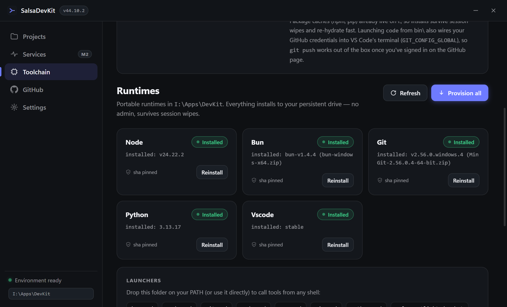
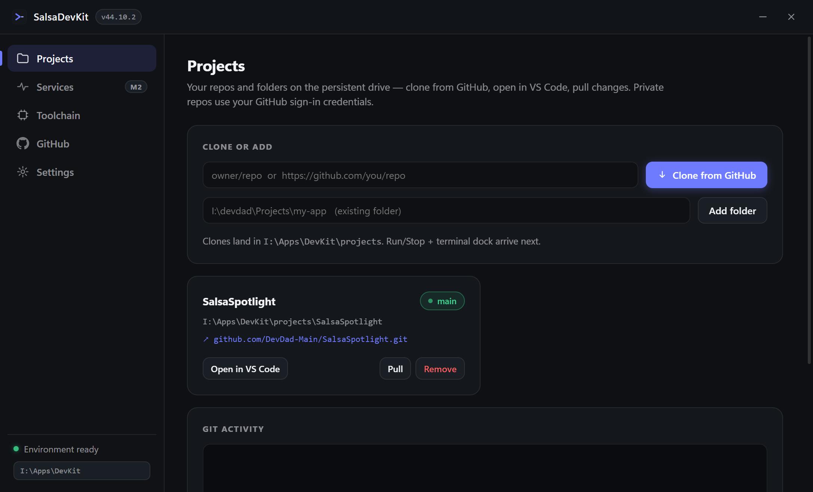

# SalsaDevKit

**A dev box that fits in a folder.**

SalsaDevKit is a portable, **no-admin-required development environment for Windows**, built for [GeForce NOW via SalsaNOW](https://salsanow.com) — and useful on any locked-down PC where you have a persistent drive but no administrator rights. One folder holds Node.js, Bun, Git, Python, VS Code (portable), every package cache, your GitHub credentials and your projects. Every session rehydrates in seconds; nothing is ever installed system-wide.

> **The pitch:** *Your GFN session becomes a full dev box. No admin, no installs, survives every reboot.*

| | |
|---|---|
|  |  |
| Toolchain — five runtimes, SHA-256 pinned, one-click provision | Projects — clone from GitHub, open in VS Code, pull changes |

## Why this exists

On GeForce NOW (via SalsaNOW):

- **C: is wiped every session.** Anything you install "normally" is gone when the session ends.
- **You have no admin rights.** No installers, no system PATH edits, no services.
- **Only your persistent drive survives** (`I:` on most setups — it varies per user).

SalsaDevKit solves all three by keeping *everything* under one configurable folder on that persistent drive: runtimes, caches, editor settings/extensions, git credentials, project configs and app data. Reboot, wipe, new session — the environment is back in seconds.

## Quick start (≈ 5 minutes)

**Prerequisites:** a Windows machine with a persistent drive, internet access, and Node.js *somewhere* for the first bootstrap only (on SalsaNOW that's already part of this setup; otherwise any LTS works).

1. **Put this folder on your persistent drive**, e.g. `I:\devdad\Projects\SalsaDevKit`.
2. **Launch it:**
   ```bat
   scripts\launch-devkit.bat
   ```
   (First run needs `npm install` once — see [Development](#development) for the full dev loop script.)
3. In the app, go to **Toolchain → Provision all**. This downloads official portable builds of Node.js, Bun, Git, Python and VS Code into your DevKit root (`I:\Apps\DevKit` by default), verifies their SHA-256 hashes and generates launcher shims. It's idempotent — re-running never touches what's already there.
4. Go to **GitHub → Sign in** (one-click OAuth, or paste a personal access token). This wires your credentials into the portable git config on your persistent drive so private repos work.
5. Go to **Projects**, clone one of your repos (`owner/repo` is enough) or add an existing folder, then hit **Open in VS Code**.

That's it — you now have a full dev environment that survives every session wipe.

## What's inside

```
SalsaDevKit\                  ← this repo (code + manifest; lives on your persistent drive)
├── main.js                   Electron main: window, tray, hotkey, IPC
├── preload.js                contextBridge → window.devkit (contextIsolation on)
├── provision.js              M0 provisioner — dependency-free Node script
├── manifest.json             runtime definitions + pinned SHA-256s + shim specs
├── lib\                      paths · toolchain · github-auth · projects · env
├── renderer\                 index.html / style.css / renderer.js (no build step)
└── scripts\                  launch-devkit.bat, run-devkit.ps1, smoke tests

I:\Apps\DevKit\               ← the DevKit ROOT (runtime state; default, configurable in Settings)
├── runtimes\                 node · bun · git · python · vscode\code  (portable builds)
├── bin\                      launcher shims: node npm bun git python pip code.cmd
├── cache\npm …               package caches — installs persist across sessions
├── state\                    install markers, github.json, git-credentials
├── data\salsadevkit          app settings (Electron userData relocated here)
├── data\gitconfig            portable git config (credential helper + identity)
├── vscode\data|ext           VS Code user-data + extensions — survive wipes too
└── projects.json             the project registry
```

Two layers, one promise:

- **Backend ("DevKit")** — `provision.js` + `manifest.json`: a dependency-free Node provisioner that downloads official portable runtimes into the root, pins SHA-256s trust-on-first-use, and generates PATH-injecting shims. Idempotent via state markers.
- **Frontend ("SalsaDevKit Control")** — an Electron tray + window app: Toolchain manager, GitHub sign-in, Projects registry (clone / add / pull / open in VS Code), and a central Settings hub.

## Using the runtimes while coding

The `bin\` folder contains shims that set PATH for you. From any shell:

```bat
:: cmd
set PATH=I:\Apps\DevKit\bin;%PATH%
```
```powershell
# pwsh
$env:PATH = "I:\Apps\DevKit\bin;$env:PATH"
```

Now `node`, `npm`, `bun`, `git`, `python`, `pip` and `code` all resolve to the portable copies, with npm/pip caches already pointed at your persistent drive. In VS Code's integrated terminal this is automatic when you launch via the `code` shim (it also sets `GIT_CONFIG_GLOBAL`, so **`git push` works out of the box** once you've signed in).

## GitHub authentication

Three ways in, all token-based, all stored on your persistent drive:

1. **One-click "Sign in with GitHub"** — authorization-code + PKCE flow against a loopback server; no client secret involved. Needs an OAuth App registered once under your account: github.com/settings/developers → New OAuth App, callback URL exactly `http://127.0.0.1:8465/callback` (SalsaDevKit's standard redirect URI — fixed port so it always matches).
2. **Device flow** — paste a code at github.com/login/device.
3. **Personal access token** — fine-grained or classic with `repo` + `read:user`.

After sign-in the app writes:

- `<root>\state\github.json` — auth state (token never leaves the main process)
- `<root>\data\gitconfig` — portable git config: credential helper → file store, plus your name/email for commits
- `<root>\state\git-credentials` — `https://x-access-token:…@github.com`

Every git operation the app performs (and VS Code's terminal, via the shim) uses that config through `GIT_CONFIG_GLOBAL`, so it works no matter how many times C: has been wiped.

## Trust model & guarantees

- **Official sources only** — nodejs.org, oven-sh/bun releases, Git for Windows releases, python.org FTP, VS Code's update CDN.
- **SHA-256 pinned in `manifest.json`** (trust-on-first-use: the first verified download pins its hash; later installs must match).
- **Idempotent & resumable-friendly** — state markers under `<root>\state\`; re-running never re-downloads what's healthy.
- **No admin, ever.** No installers, no registry writes outside HKCU, no system PATH edits.
- **Nothing lives on C:.** All state is under the DevKit root (default `I:\Apps\DevKit`, changeable in Settings — with a warning if you point it at C:).

## For SalsaNOW users

- **Drive letter varies per user.** If your persistent drive isn't `I:`, open **Settings → DevKit root** on first launch and set e.g. `D:\Apps\DevKit` (the app migrates its settings and relaunches).
- **SmartScreen:** the unsigned Electron binary will be flagged — *More info → Run anyway*. Code signing is a later milestone, not a blocker.
- **Auto-launch each session:** add the launcher to your SalsaNOW `StartupBatch.bat` so the environment is warm when you land (a helper for this lands in M3).

## Roadmap

| Milestone | Status | What it is |
|---|---|---|
| **M0** — provisioner + manifest | ✅ done | All five runtimes installable, verified, idempotent |
| **M1** — app shell | ✅ shipped | Window/tray/hotkey, Toolchain page with live provisioning log, GitHub sign-in (OAuth PKCE / device / PAT), Settings hub |
| **M2** — Projects & Services | 🚧 in progress | Project registry: clone from GitHub, add folders, pull, open in VS Code, live branch/dirty status. Next: Run/Stop with port probing + xterm.js terminal dock + services dashboard |
| **M3** — community release 1.0 | planned | Doctor flow, export/import all state as one file, portable build via electron-builder, onboarding docs, StartupBatch helper |
| **M4** — extras | planned | Monaco quick-editor panel, Rust/Go runtimes (GNU target), CUDA toolkit entry, runtime auto-update from manifest |

## Development

Plain JS, no framework, no build step — match the style: small files, defensive logging to file instead of crashing.

```bat
:: full dev loop: npm install if needed + electron binary fix (npm C8 gotcha) + launch
I:\Apps\SalsaNOW\SilentApps\Powershell\pwsh.exe -NoProfile -File scripts\run-devkit.ps1

:: syntax-check everything
scripts\check-syntax  (or: node --check on each file, portable node at I:\Apps\DevKit\runtimes\node)

:: headless smoke test for the projects/git layer (clones a tiny public repo, cleans up after itself)
I:\Apps\DevKit\runtimes\node\node.exe scripts\smoke-projects.js

:: re-generate bin shims after editing manifest.json (skips installed runtimes)
I:\Apps\DevKit\runtimes\node\node.exe provision.js
```

Ground rules for contributors: never write outside the DevKit root + app userData; never require admin; never assume C: persists; every download from an official source with a pinned hash.

## License

MIT — see [LICENSE](LICENSE).
